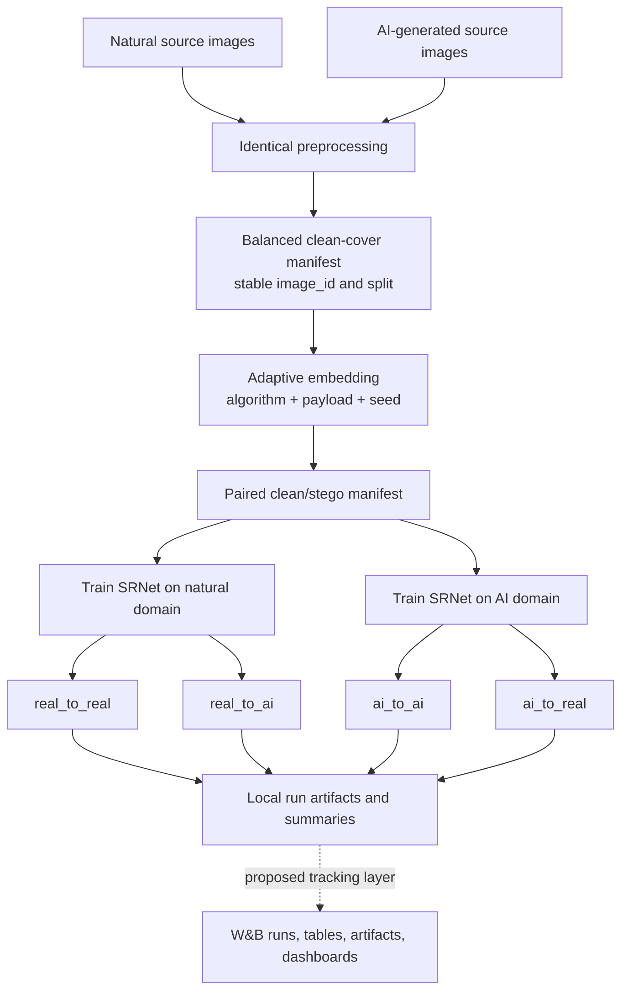

# Pipeline Summary and Experiment Plan

## Why this note exists

This is the central planning document for turning the current repository into a repeatable experiment pipeline. It separates:

- **Implemented and observed** — present in the repository now.
- **Accepted** — recorded in [[Decisions]].
- **Proposed** — a recommendation that still needs review.
- **Open** — unresolved work or a decision that blocks final experiments.

The goal is to freeze the protocol once, validate it on a small run, and then run the final experiment matrix without changing methods midway.

## Thesis in one paragraph

The project studies **binary steganalysis**: detecting whether an image is clean or contains an embedded payload. The experimental variable is the cover domain—natural images versus AI-generated images. The central issue is **cover-source mismatch**: a detector trained on one domain may learn domain-specific residual statistics and fail when evaluated on the other. This is not an AI-image detector; both domains contain clean and stego examples, and the classifier predicts only `clean` or `stego`.

## Research questions

1. Under the same embedding method, payload, preprocessing, and detector training procedure, is steganography easier or harder to detect in AI-generated covers than in natural covers?
2. How well does a steganalyzer trained on natural covers transfer to AI-generated covers?
3. Is any transfer failure asymmetric—that is, does AI-to-natural transfer behave differently from natural-to-AI transfer?
4. Do the conclusions remain stable across random seeds and selected embedding conditions?

## Experimental comparison

| Direction | Training data | Test data | Interpretation |
|---|---|---|---|
| `real_to_real` | Natural clean/stego | Natural clean/stego | Same-domain natural control |
| `ai_to_ai` | AI clean/stego | AI clean/stego | Same-domain AI detectability |
| `real_to_ai` | Natural clean/stego | AI clean/stego | Main transfer question |
| `ai_to_real` | AI clean/stego | Natural clean/stego | Reverse-transfer control |

The most informative quantities are not isolated accuracy values, but controlled contrasts such as `real_to_ai` versus `real_to_real`, with all non-domain variables held fixed.

## What exists now

### Dataset preparation

**Implemented and observed**

- `src/datasets/pipeline.py` handles source acquisition/preparation, balances natural and AI covers, and applies the same crop, grayscale, resize, and PNG conversion path to both domains.
- `src/datasets/manifest.py` creates and validates manifests with stable image identifiers and split information.
- The documented default normalized image size is 256×256.
- GenImage and Kaggle-oriented acquisition paths are documented in `README.md`; the final thesis source and subset have not been accepted.

### Steganographic embedding

**Implemented and observed**

- `src/steganography/core.py` uses `conseal` for WOW, S-UNIWARD, HILL, and MiPOD.
- Supported benchmark payload settings are 0.1, 0.2, and 0.4 bits per pixel.
- Embedding uses explicit seeds and can reuse cached stego outputs.
- Each benchmark run writes a configuration, copied manifest, and generated stego images.
- OpenStego and code under `src/legacy/` are demonstrations or historical prototypes, not primary research evidence.

### Detector and evaluation

**Implemented and observed**

- `src/steganalysis/srnet.py` adapts a pinned external SRNet implementation.
- `src/steganalysis/experiments.py` trains one model on natural pairs and one model on AI pairs for each seed, then evaluates all four directions.
- The runner validates the stego manifest and checks that a pair's `image_id` is not assigned to different splits.
- Current output includes a copied dataset manifest, `config.json`, and `summary.json`.
- Current final metrics are accuracy, balanced accuracy, precision, recall, F1, and confusion matrices, summarized by mean and standard deviation across seeds.
- On 2026-08-31, all eight repository unit tests passed in the `experimental_1` environment. This validates the tested pipeline behaviors, not the scientific adequacy of a final run.

## Current end-to-end architecture

## Non-negotiable controls

These are accepted requirements or repository instructions:

- Keep each clean/stego pair in the same train, validation, or test split.
- Apply equivalent preprocessing to natural and AI covers.
- For a controlled comparison, hold algorithm, payload, split policy, and detector procedure fixed while changing the cover domain.
- Preserve the seed, manifests, detector version, embedding condition, and domain direction for every result.
- Do not use legacy LSB or recoverable OpenStego demonstrations as the primary adaptive-steganography benchmark.
- Do not treat smoke-test results as thesis findings.
- Keep local configuration and result files as reproducible records even if W&B is enabled.

## What is not ready yet

### Scientific protocol

- **Open:** final natural-image and AI-image dataset sources.
- **Open:** dataset audit results, usable sample count, class balance, duplicates, corrupt files, licenses, and storage requirements.
- **Open:** final train/validation/test counts and whether semantic class matching is required.
- **Open:** final algorithm × payload matrix and how much is primary versus robustness analysis.
- **Open:** number of seeds justified by compute and variance.
- **Open:** primary outcome, statistical comparison, uncertainty intervals, and decision rule for each research question.
- **Open:** external-source robustness test, if any.

### Pipeline and reproducibility

- Training metrics are printed but are not returned or saved as structured epoch history.
- Validation accuracy and other validation metrics are not calculated; validation currently selects the best in-memory state by loss.
- The best model state is not written as a checkpoint.
- Test probabilities are produced by `predict_srnet` but discarded by the experiment runner. This prevents ROC/PR analysis, threshold analysis, calibration checks, and per-image error review.
- Per-seed results are held while the process runs but only aggregated output is written to `summary.json`; there is no explicit per-seed prediction file.
- The result record does not yet capture all desired provenance, such as embedding algorithm/payload parsed from the manifest, manifest hash, repository commit/diff state, dependency versions, dataset counts, run duration, or hardware.
- A failed multi-seed run has no documented resume/idempotency behavior.
- There is no single frozen experiment configuration file covering dataset, embedding, training, evaluation, and tracking.
- Full-scale runtime, memory, disk, and failure behavior have not been measured.

### Results and reporting

- No final dashboard, result-table generator, or thesis-figure generator exists.
- No confidence-interval or paired statistical analysis has been accepted.
- No formal failure-case protocol has been defined.
- Existing small outputs must remain labeled smoke or development results until a frozen protocol is executed.

## Proposed protocol for review—not yet accepted

This section is a starting point for discussion, not a recorded decision.

### Dataset recommendation

- Use one generator subset from **GenImage** as the main AI domain and its corresponding natural ImageNet covers as the main natural domain. Stable Diffusion 1.4 is a practical candidate because it creates a clear, reproducible main comparison.
- Audit the available files before accepting exact counts. A possible target, if the audit and compute budget support it, is 20,000 covers per domain with 14,000 train, 2,000 validation, and 4,000 test covers per domain.
- Keep source-image identity and semantic class balanced where the source metadata permits it.
- If time permits, add a second generator, such as Wukong, only as an external robustness test rather than mixing multiple generators into the main AI domain.
- Consider BOSSBase/BOWS2 only as an auxiliary implementation benchmark. Do not merge it into the main natural-versus-AI comparison because its image source and processing pipeline differ.

### Accepted embedding matrix

- Primary: S-UNIWARD at 0.2 and 0.4 bpp, with three seeds.
- First robustness condition: MiPOD at 0.4 bpp, with three seeds.
- Later extension: HILL at 0.4 bpp, only if compute permits.
- WOW: optional and separately labelled as a cross-algorithm test.
- S-UNIWARD at 0.1 bpp: later optional difficult condition.
- LSB: excluded from the research matrix; legacy demonstrations remain separate.

### Experimental unit

A useful definition is: **one W&B/local run = one training domain × one seed × one embedding condition**. That trained model can then be evaluated on both test domains. This gives two training runs per seed and condition, with two evaluation directions attached to each run. A separate protocol-level summary aggregates all seeds and all four directions.

## Proposed W&B tracking design

W&B should be an optional observability and collaboration layer; local JSON/JSONL files remain the portable source records.

### Run configuration

Record at least:

- protocol version or frozen configuration identifier;
- dataset source/subset, manifest path and content hash, counts by domain/class/split;
- preprocessing size and format;
- embedding algorithm, payload, embedding seed, and cache/run identifier;
- detector name and pinned commit;
- training domain, test domains, training seed, epochs, batch size, optimizer, and learning rate;
- hardware/device, dependency/environment identifier, repository commit, and dirty-worktree flag;
- W&B project, group, tags, job type, and run ID.

### Logged history and summaries

- Per epoch: training loss, training accuracy, validation loss, validation accuracy, epoch duration, and learning rate.
- Per evaluation direction: accuracy, balanced accuracy, precision, recall, F1, confusion matrix, and sample count.
- When probabilities are retained: ROC-AUC, PR-AUC, ROC/PR curves, score distributions, and threshold-dependent metrics.
- Per-image table: `image_id`, domain, clean/stego label, prediction, stego probability, split, algorithm, payload, and whether the prediction was correct. Avoid uploading payload contents or unnecessary source images.

### Artifacts

- Log the frozen configuration, manifest or manifest hash, per-seed metrics, predictions table, summary, and selected checkpoint.
- Decide retention and storage limits before uploading checkpoints or images.
- Do not upload the full image dataset by default. Prefer immutable local paths plus hashes, or an approved external storage reference.
- Never store the W&B API key in the repository.

### Dashboard for project review

The first dashboard should answer the thesis questions directly:

1. Four-direction balanced accuracy and F1 with seed variability.
2. Same-domain versus cross-domain performance gaps.
3. Learning curves by training domain.
4. Confusion matrices by direction.
5. Algorithm and payload comparisons.
6. Per-seed scatter or distribution plots so instability is visible.
7. If scores are retained, ROC/PR curves and clean-versus-stego score distributions.
8. A table of failed, interrupted, smoke, and final runs so they cannot be confused.

Use offline or disabled mode for local tests, then explicitly sync approved runs. Start W&B Sweeps only after one tracked run is correct and reproducible; a sweep cannot compensate for an unfrozen scientific protocol.

## Gates before final experiments

### Gate 1 — Freeze the scientific design

- Dataset sources and audited counts accepted.
- Main and robustness embedding conditions accepted.
- Split policy, seeds, metrics, statistical analysis, and stopping criteria recorded in [[Decisions]].
- Compute and storage estimate accepted.

### Gate 2 — Make one run fully observable

- Epoch history, per-seed results, probabilities/predictions, checkpoint, timing, and complete provenance are saved locally.
- Optional W&B logging reproduces the local values and works in disabled/offline mode.
- Interrupted-run behavior is tested.

### Gate 3 — Preflight validation

- Automated tests pass.
- Manifest audit shows no pair leakage, cross-split duplicate identity, missing files, or domain/class imbalance outside the accepted policy.
- A tiny end-to-end smoke run produces all expected files and dashboard panels.
- A small representative pilot estimates runtime and catches memory/storage issues; its outputs remain labeled `pilot`.

### Gate 4 — Execute and lock final runs

- Run the frozen matrix without mid-run method changes.
- Record failures and reruns rather than overwriting them.
- Aggregate seeds, generate uncertainty estimates, inspect failure cases, and export final tables/figures from the preserved results.

## Open review questions

1. Is cover-source mismatch the clearest central contribution, or should the thesis narrow further?
2. Is one main generator plus one external generator a cleaner design than combining several generators?
3. Are semantic classes matched strongly enough to prevent scene/content shortcuts?
4. Is the proposed dataset size realistic for SRNet training on available hardware?
5. Which embedding conditions are essential to support the claim, and which are optional robustness checks?
6. What is the primary statistical contrast and uncertainty estimate?
7. Should models be trained separately per embedding algorithm/payload, or is a mixed-condition detector scientifically useful as a secondary experiment?
8. Which failure cases or residual-domain diagnostics would best reveal what the detector learned?
9. Does the W&B run definition make comparisons easy without fragmenting one protocol into too many runs?
10. What minimum evidence must be complete before results can be called final rather than exploratory?

## Related notes

- [[Methods and Findings]] — consolidated evidence and threats to validity for thesis writing.
- [[Project Overview]] — short orientation.
- [[Architecture]] — component boundaries and data flow.
- [[Decisions]] — accepted choices; the authority for protocol decisions.
- [[Experiment Decisions]] — concise human-readable experiment plan.
- [[Tasks]] — implementation and research checklist.
- [[Development Log]] — chronological work and experiment record.
- [[Ideas]] — possibilities that have not been accepted.
